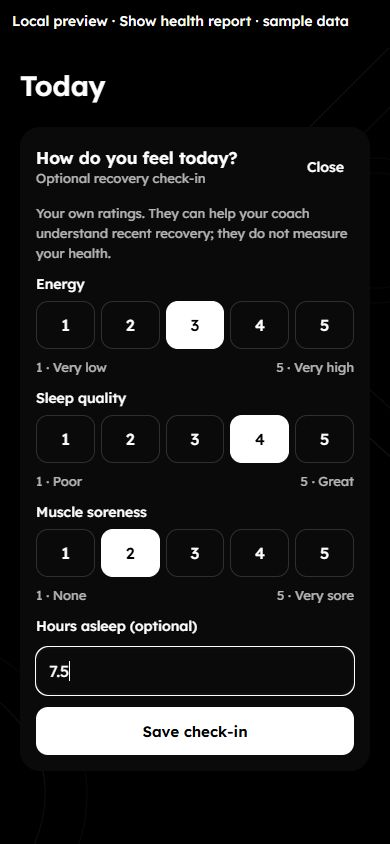
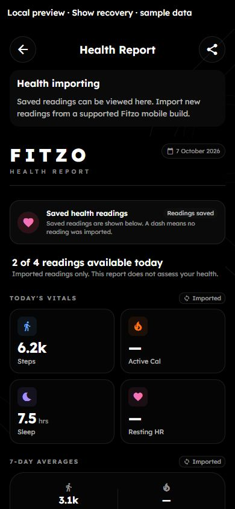

# Health, recovery and clearer loading states

Implemented in the working tree on 7 October 2026, following the [onboarding and Today pass](2026-10-07-onboarding-and-ui-pass.md). These changes have not been built or released to the App Store, and the backend has not been deployed.

## Changes

- Health imports now keep per-account, per-device timestamps for the last check and last successful upload. Settings and Health Report expose them. Manual, foreground, historical and background imports share the same recording path.
- Empty results, unfinished uploads, incomplete native queries and old imports have distinct explanations. Empty HealthKit results do **not** prove read permission was denied. Individual native query failures retain their unknown metrics while other readable metrics can still be uploaded. An unavailable Android health service is no longer counted as a successful empty check.
- Health Report has an optional in-context Continue action before a native permission request and a manual Sync now action after imports are enabled. Controls and device import history sit outside the shared report capture. Unknown readings remain dashes, genuine zero readings remain zero, and failed report loads cannot be exported.
- Removed the report's arbitrary A–F health grade and generic resting-heart-rate/activity targets. Coverage now says how many of the four readings are available today. The steps chart shows true zero without a fabricated minimum bar, runs from older to newer dates, uses the recorded calendar day for weekday labels, and explains that missing days are omitted.
- Today includes a collapsed, optional recovery check-in: self-rated energy, sleep quality and soreness, plus optional hours asleep. No answers are preselected. It supports editing, validation, retry and retained answers after a failed save. It presents ratings rather than a health/readiness score and does not gate workout logging.
- The readiness API now validates integer ratings, finite sleep hours, dates and bounded notes. It preserves zero hours and existing notes when an edit omits them. Reads and writes accept the device calendar date, with an IST fallback for old clients. Daily upsert behaviour remains unchanged; no migration is needed for these route changes.
- Saving health or recovery data awaits coach-context invalidation. The coach prompt describes recovery ratings as subjective context, and no longer translates those ratings into a claim that maximal effort is warranted. Legacy readiness scores remain in storage/API responses for compatibility; the new check-in does not display them.
- Coach uses the shared AI consent source and disclosure instead of its outdated, separate Gemini-only screen and hardcoded consent key. The shared copy identifies questions, saved profile, food, training, recovery and imported readings as possible context. Failed conversation-history loading is visible.
- The food logger distinguishes loading, failed refresh and a genuinely empty daily log. A failed refresh keeps previously loaded entries and offers retry. Older overlapping responses cannot overwrite the latest load.

## Verification

- Mobile TypeScript passed. Full mobile regression suite: **34 suites, 294 tests passed**.
- Full backend regression suite: **46 suites, 458 tests passed**. Readiness validation and actual PostgreSQL-compatible upsert SQL were exercised with synthetic users in PGlite, including repeat saves, zero hours, note preservation/clearing and matching date reads. No production records were written.
- ESLint found no errors in the new health-status/check-in code or report changes. Existing native-module `require` warnings and pre-existing warnings in broader screens remain; this is not a claim of repository-wide lint cleanliness.
- Expo web preview used a temporary local fixture with synthetic readings and in-memory check-in saves. The fixture was removed after verification. Recovery selection, saving and editing were exercised at 390×844; small-screen layout/tap targets at 320×568 and tablet layout at 820×1180 were checked. No horizontal page overflow or sub-44-pixel rating controls were found. Preview console errors were empty.
- Partial readings in the report were checked at 390×844 and 320×568. The preview showed two readings and two dashes, rather than assigning a health grade. Web lacks native health services, so it cannot verify the native connection/sync buttons or background delivery.

Preview images (sample data):

## Remaining work

- Physical iPhone/Android verification: native permission requests and refusal, partial permissions, locked devices, revoked access, repeated 30-day imports, timezone/day boundaries, foreground recovery and background scheduling. The operating system controls background execution; code/tests do not guarantee delivery.
- Native keyboard overlap, large text, VoiceOver/TalkBack and the complete existing-account/new-account onboarding flow.
- A coordinated backend deployment and app build before users receive these changes. Verify the existing readiness table in the deployment database; this session did not inspect production schema or migrate it.
- The larger roadmap still includes training-first onboarding without mandatory nutrition setup, experience/equipment preferences, explicit exercise prescriptions, editable coach memory and confirmed coach actions. Those items are not completed by this pass.

Manager features and staging remain outside this work.
