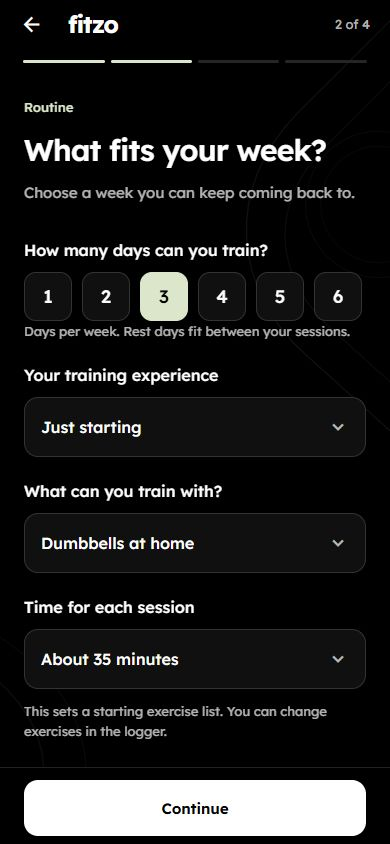
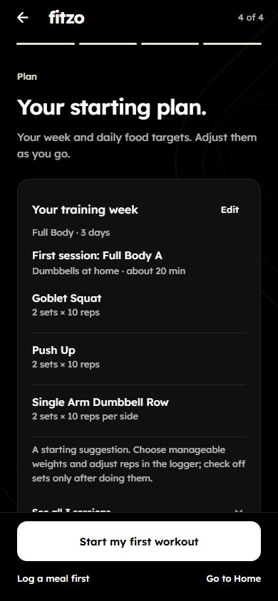
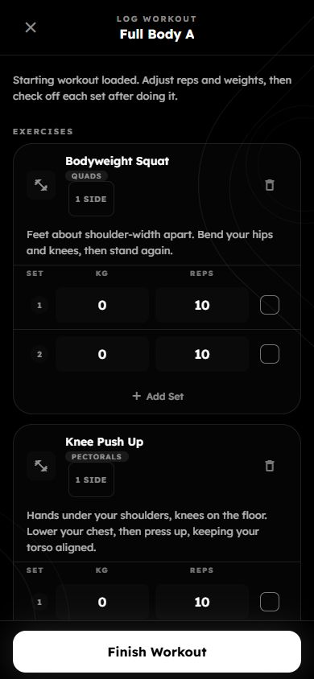

# Routine and first-workout pass — 8 October 2026

## Result

Onboarding now asks training experience, equipment and approximate session length alongside days per week. These answers control a specific exercise template, rather than only day labels. Everyday activity moved to the food-basics stage to keep the routine screen focused. Each new choice is explicit; older drafts keep valid answers and return to the unanswered routine stage.

The plan shows the first exercise list, set/repetition suggestions, equipment and time. The training Edit action returns to the saved routine answers. “Start my first workout” opens the reviewed day directly in the existing logger, without another day-selection form. This navigation supplies a local session label; it does not publish a daily intent or record any performed work.

Gym templates use machines, cables and dumbbells. Home dumbbell templates require no bench. Floor templates need no equipment and disclose limited pulling options. Longer regular-adult sessions use three sets; new/returning users, short sessions and users under 18 use two. Session time limits exercise count and is approximate. These are editable starting suggestions, not an injury-aware programme or an assurance of results. See the [rationale and next steps](../roadmap/2026-10-08-next-steps.md).

## Storage and logging

- Migration `021_starter_workout_plan.sql` adds a nullable JSONB template to `user_splits`. Existing custom/adopted splits and all historical logs remain unchanged. The migration has been tested locally, not applied to the live database.
- Split saving validates preferences, exercise identifiers, equipment compatibility, set/repetition bounds and agreement with the schedule before opening a transaction. Saving the template is atomic with activation of the split. A missing column or failed insert rolls back deactivation of the existing split. Legacy saves without a template do not reference the new column.
- Coach context reads saved training preferences, with cache invalidation after saving. Its split query tolerates the column being absent. Shared AI-consent copy includes training preferences. No automatic coach action is added.
- An actual previous workout for the selected day takes priority over a starter template. The latest-workout endpoint matches the owning source-linked session label and completed source log, so Full Body/Upper days do not accidentally repeat a different day represented by the same legacy workout type. Older unlinked history may no longer automatically prefill a named day; manual logging and explicit templates remain available.
- Explicitly selected library templates keep priority. Late responses cannot replace manual edits, including an exercise added then removed, or populate another account's screen. Failed saved-workout loading is visible and can be retried.
- Suggested and repeated sets start unchecked. New weighted suggestions leave weight blank; bodyweight suggestions show a real 0 kg. Finishing blocks checked sets with missing weights. Unchecked suggestions produce no saved sets, volume or PRs.
- New floor movements have short cues in the logger. Weight/reps, completion, removal, add-set, template, add-exercise, voice and close controls now have descriptive accessibility roles/labels; completion exposes checked state. Key controls have at least 44-pixel height, and long exercise names can wrap. The voice action now refreshes its busy state rather than retaining a stale footer.

## Verification

Final checks: mobile TypeScript passes; **37 mobile suites / 307 tests** and **48 backend suites / 470 tests** pass. Scoped ESLint has no errors; existing unused-import, curated-effect and display-name warnings remain. `git diff --check` for mobile/backend/docs is clean. Regression coverage includes the following behaviour:

- Equipment and time combinations across all six schedule sizes; real catalogue mappings; no bench/bar requirements at home; two versus three sets; no fabricated loads; invalid/corrupt plans; repeated-workout priority; older draft restoration.
- Onboarding save ordering, failure/retry, exact saved preview and first-day navigation, Back/edit answer retention, custom calorie validation and pending buddy-invite routing.
- Actual logger integration: unchecked suggestions, missing-weight guard, no write before completed work, explicit-template priority, delayed responses after edits, failed load/retry and account changes.
- Actual SQL in an isolated PGlite database: rollback with an absent template column, repeatable migration, JSON persistence/readback, one active split, no performed-log insertion, and previous-workout day/owner/completion scoping. No production data is read or written by these tests.

Browser evidence uses the real Expo web screens with synthetic data and mocked API responses, at 390×844, 320×568 and 820×1180. Routine selection, Continue, Edit, changed equipment, saved-answer retention and workout display were exercised. No horizontal overflow or console errors were observed. Tested onboarding controls and logger controls met the 44-pixel height check. This is web evidence, not native-device certification. The temporary preview route and its API mocks were removed afterwards.

Other captures: `routine-320.jpg`, `plan-320.jpg`, `bodyweight-plan-tablet.jpg`, `logger-320.jpg` in the same asset directory.

## Remaining work and release order

Post-setup training preference editing/removal, nutrition-optional onboarding, user-visible coach memory, confirmed coach actions and meal suggestions remain pending in the [next-steps plan](../roadmap/2026-10-08-next-steps.md). First-workout templates do not implement injury restrictions or individual progression. Existing broad goals and nutrition target policy are unchanged.

Physical-device keyboard/large-text/VoiceOver/TalkBack verification and HealthKit/Health Connect backfill/background checks remain pending. No build, commit, push, backend deployment or App Store submission was made by this pass. Release migration 021, then the backend, then the matching mobile build; releasing only the new frontend would leave the new template persistence unsupported.
