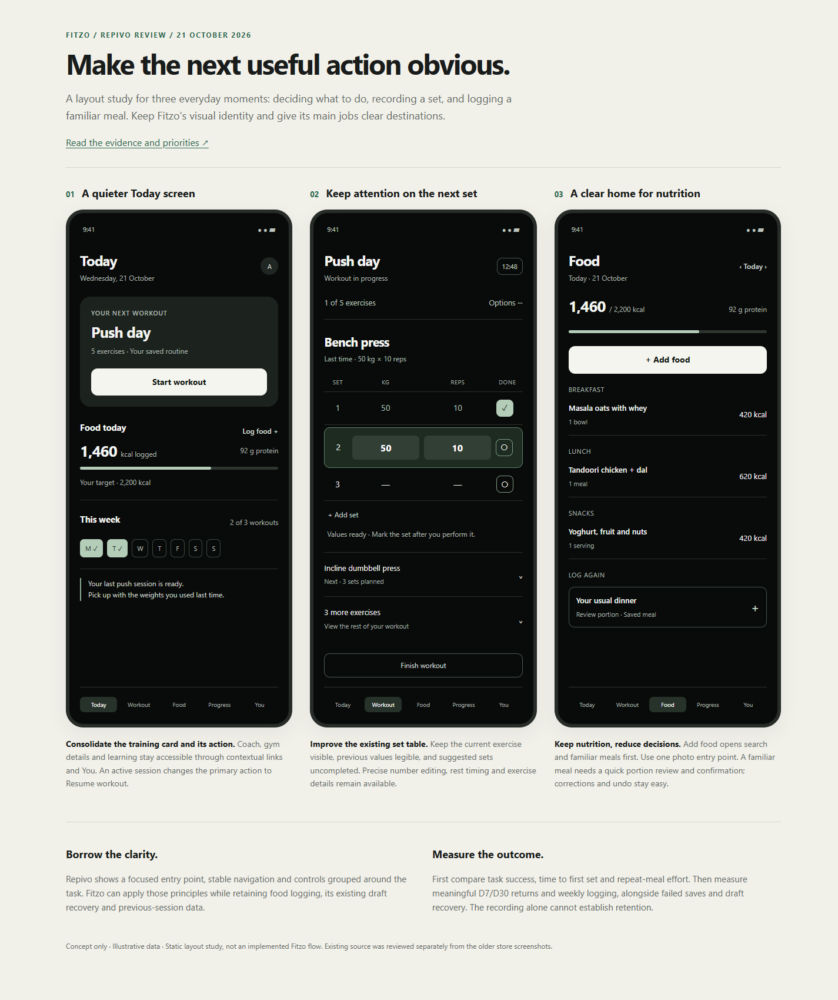
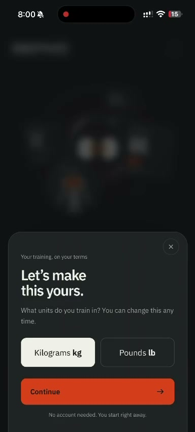
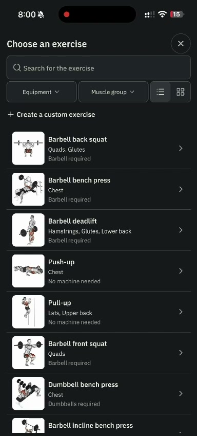
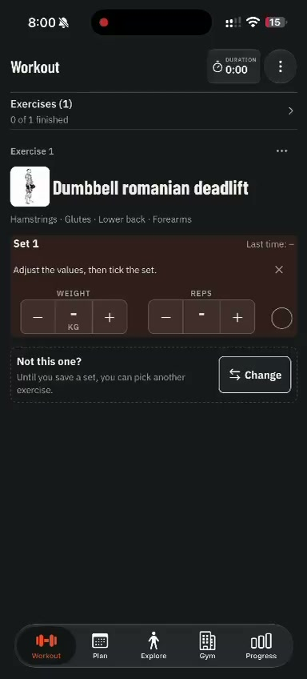
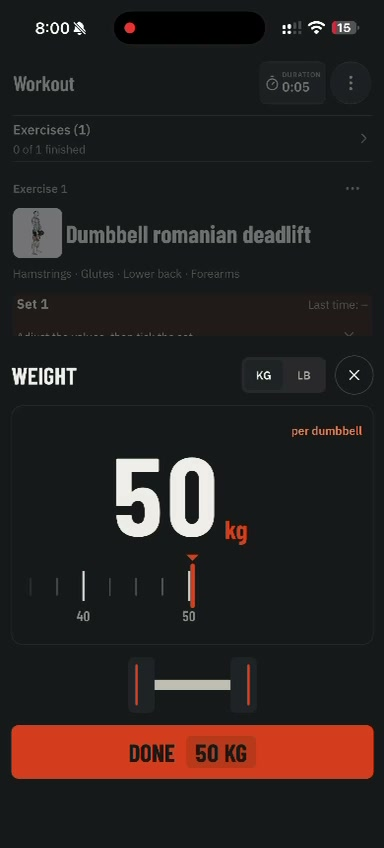
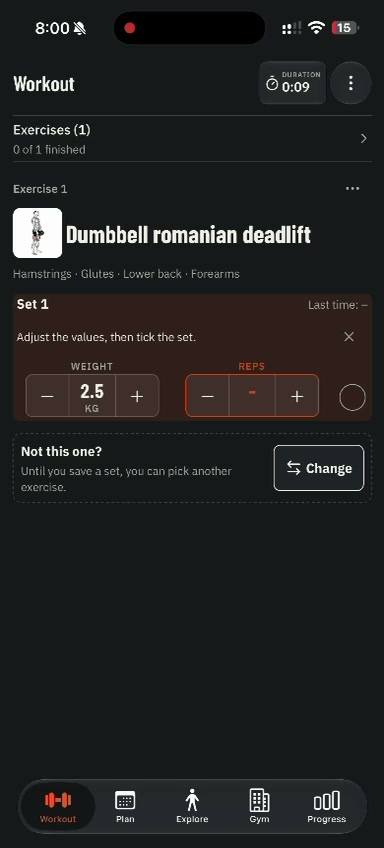
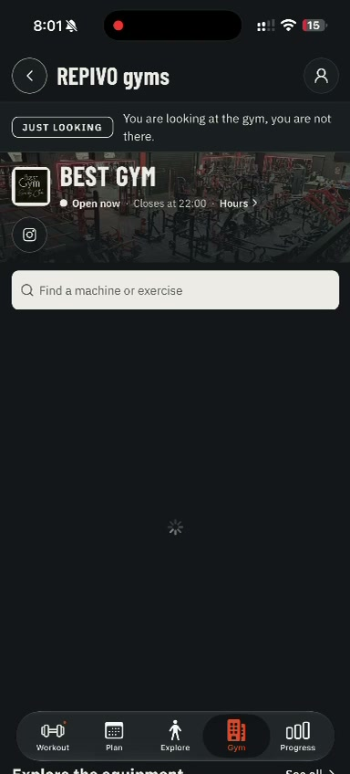

# Repivo → Fitzo: usability and retention review

21 October 2026 · Recommendations, with no changes to the application

**Recommendation: make Fitzo's everyday actions easier to reach and repeat. Keep workout and nutrition tracking; give each a clearer place.** Repivo's strongest lesson is the short distance between opening the app and doing something useful. A different colour scheme alone would not deliver that benefit.

Start with three changes: **direct access to Workout and Food, a first-workout path that does not require choosing a split, and fewer interactions to repeat a set or meal.** Then simplify the surrounding visuals and improve the reason to return after a completed workout.

[Open the proposed three-screen layout study](./layout-study.html). All numbers and exercise names in that study are illustrative.

## What this review establishes

- Reviewed the supplied 96.24-second, 384 × 848 screen recording, using frames throughout and denser sampling around onboarding and workout input. Source: `C:/Users/PC/Downloads/WhatsApp Video 2026-10-21 at 8.04.18 PM.mp4`.
- Compared it with the current local Fitzo navigation, home, onboarding, workout, exercise picker, food logger and recap source, including today's uncommitted changes.
- Inspected Fitzo's existing home and nutrition screenshots. **Those images are from 27 August and lag behind the source.** For example, today's source already places workout actions before the coach and gym sections, and food search before presets. Recommendations below account for that work.
- Checked Repivo's official product description and established usability guidance.

This is an expert review, not a user study. No new device performance measurements, user interviews or retention analytics were collected. The recording does not establish Repivo's popularity or retention, does not show a completed set or workout, and does not open its Progress tab. The absence of calorie logging in the recording does not prove it is absent from every version of the product.

## What Repivo does well in this recording

| Approximate video time | Visible behaviour | Lesson for Fitzo |
|---|---|---|
| 00:00–00:05 | A single Get started action leads to a sheet asking for kg or lb; an account is not required for this start flow. | Ask for the information needed for the next action. Let training begin before the full plan is configured. |
| 00:05–00:18 | The Workout landing screen offers search, muscle filters, one prominent Choose an exercise action and a secondary scanning action. | Make the next action obvious. Secondary features can stay available with less visual weight. |
| 00:18–00:23 | Exercise rows combine a recognisable illustration with name and equipment; details show movement guidance before Start. | Make selection easy to recognise. Keep instructions available when needed. |
| 00:23–00:32 | The active exercise presents weight, reps and a completion control together. A large weight sheet isolates one editing task. | Keep logging controls together and preserve the surrounding workout when editing. |
| 00:32–00:34 | Plan separates the current week from routines and gives an empty day a clear add action. | Separate planning from execution; make empty states actionable. |
| Throughout | Workout, Plan, Explore, Gym and Progress remain in stable positions; the active tab has a distinct accent. | Navigation communicates the app's main jobs. Fitzo's daily jobs should be equally discoverable. |

Repivo also anchors its official positioning around a useful loop: find the machine, see the previous session, save the next set. That supports continuity between visits. It is a product claim, rather than an interaction fully demonstrated by this recording. [Repivo's official app page](https://repivo.fit/en/app/)

**Use judgment when borrowing.** The gym page shows a spinner at both 00:52 and 00:56; this recording cannot identify the cause. The weight picker passes through several substantially different values, so it does not prove a slider is faster than precise entry. Much of the closing section sits on the scan introduction, with a camera permission prompt near the end. Scanning, progress, long-term reliability and overall frame performance remain unverified. A 3D gym map and body model should have lower priority than Fitzo's daily logging flows.

## The specific changes I recommend

### 1. Put the daily jobs in the navigation

**Proposed tabs: Today · Workout · Food · Progress · You.**

Currently, the tabs are Home, Friends, an unlabelled central +, Learn and Profile. The + opens another choice between workout logging, calorie logging and the exercise library. Stats exists as a hidden tab route. The two main logging jobs have less permanent visibility than supporting features.

Give Workout and Food direct destinations. Put plans, saved routines and the exercise library within Workout. Put Friends, Learn and gym information in clearly labelled sections under You initially, with contextual links where relevant. Keep an existing user's active session reachable from every destination. Coach advice can appear beside relevant workout or food information.

This is a hypothesis about a better default, not evidence that community is unimportant. First check whether Friends or Learn is a primary return destination for a meaningful cohort; preserve a visible shortcut for those users during a navigation trial.

**Acceptance:** users can find and open either logger in one navigation tap, without first interpreting a + menu. Preserve existing routes and saved state during migration.

### 2. Turn Home into a short, useful Today screen

Fitzo already moves in this direction in today's source. Continue that improvement by consolidating the training summary and its action:

1. A compact heading and date; profile/settings in one predictable place.
2. One training block: today's routine and **Start workout**, or **Resume workout** when a session exists.
3. A compact nutrition block: calories logged, protein, and **Log food**. Show targets only when configured, and make missing entries clear.
4. Weekly workout progress, followed by one useful contextual insight.

Move the fuller coach card, gym crowd information, learning content and buddy previews into their own destinations or a secondary section. A training-only user should see a compact, optional nutrition invitation rather than an empty nutrition dashboard.

The current home source still combines the header's coach/check-in/streak controls, training information, logging actions, food summary, weekly progress, coach card, gym status, learning and buddies. Reduce that competition. Avoid restating a routine in one card and placing its action in another.

**Acceptance:** the next workout action is visible without scrolling on representative small phones at default text size; enlarged text remains usable without clipping. An active workout replaces the start action with Resume. No automatic scroll reset during background refresh.

### 3. Let a first workout start before a split is configured

Today, Home's no-intent/no-suggestion fallback opens the workout-intent screen, which offers split selection and other planning choices. The main onboarding wizard has three or four stages, depending on whether nutrition is enabled. That provides a personalised plan, but it is more setup than someone needs to record a single exercise.

Offer two explicit paths:

- **Start a workout:** choose an exercise → enter weight and reps → mark the set done.
- **Build my plan:** enter the existing planning flow.

Allow an unnamed/custom session and offer to save it as a routine after completion. Ask for nutrition-specific details when the user enables nutrition targets. The existing optional nutrition choice is a good foundation.

Guest training is a possible later experiment. It requires deliberate handling of local drafts and account merging, so it should not hold up the simpler signed-in quick-start improvement.

**Acceptance:** a signed-in user with no split can record a set without choosing a programme. Planning remains optional and discoverable.

### 4. Make repeat workouts feel effortless

**Preserve what already exists.** Fitzo already restores active workouts, loads matching saved/previous workout drafts, carries previous-set hints, offers precise number entry as well as a wheel, and has an optional rest timer. These are useful strengths.

Improve their presentation:

- Put recent exercises before the general catalogue when adding an exercise. Retain search, illustrations and filters. Offer an obvious way to include exercises outside the suggested session's muscles.
- Keep the active exercise and next uncompleted set prominent. Collapse other exercises to readable summaries, with an expand-all option for users who prefer the current table.
- Show **Last time: 50 kg × 10** in one stable place. When the row is empty, provide **Use last values** rather than requiring two separate number edits.
- Let users change kg and reps in one compact editing surface, or advance directly from one field to the next. Keep precise keyboard entry and quick increments.
- Keep completed rows distinguishable by a check and text, with undo. Suggested values must remain uncompleted until the user confirms the set.
- Collapse the warm-up and session metadata after the user begins logging. Keep Finish workout reachable without dominating every set interaction.

The current set table already groups the right data. Refine its interaction cost before replacing it with a novel control. RIR is already optional; keep that preference.

**Acceptance:** a row with valid prefilled values can be completed in one tap. An empty row can reuse previous values with one action and then be completed. Drafts survive navigation/relaunch, invalid entries cannot be confirmed, and restored suggestions never count as performed work.

### 5. Give food the same clarity as workout logging

Nutrition is a useful part of Fitzo's proposition. Make repeat meals especially easy:

- Food opens to today's meal list and a clearly labelled Add food action.
- Add food opens with search, followed by Recents and Saved meals. Keep useful Indian meal presets accessible as a labelled category.
- Remove the duplicated camera emphasis: today's code includes a photo icon in search and a separate Log with Camera banner. Choose one clear entry point.
- Use a compact portion sheet with the previous portion, meal type and one **Add food** action. Show nutrition details on request.
- After saving, update the meal list and totals immediately, show confirmation and offer Undo. Retain the existing Add another food and Done options.

Fitzo already has frequent-food/custom shortcuts and previous-portion handling. Improve access to those existing capabilities. Keep photo estimates reviewable before saving, and provide a path to correct portions or totals.

**Acceptance:** a saved meal can be reviewed and logged in two interactions from Food; exact portions remain editable. A retry cannot create a duplicate entry. “Nothing logged” remains distinguishable from a genuinely zero total.

### 6. Make completion useful for the next visit

Fitzo's current recap makes the share receipt and **Choose style & share** the prominent outcome; Done is secondary. Keep sharing available, but make the private benefit clearer first:

- Show a brief completion summary and one accurate comparison with the relevant previous session, when available.
- Show weekly progress, such as **2 of 3 planned workouts completed**.
- Offer **Next workout: Pull · Thursday** only when the user's plan supports it, with an optional reminder at their chosen time.
- Give Done a clear exit. Keep Share secondary and optional.

For retention, test a repeatable loop: **complete something → see useful feedback → know the next action → return to familiar data**. Treat rest days as part of a plan. Favour weekly consistency over a daily streak that implies training every day. Avoid escalating reminders after a missed day.

These mechanisms are hypotheses; this recording supplies no evidence of their effect on retention.

### 7. Simplify the visual system and motion

Keep Fitzo's black-and-white identity for the first iteration. Repivo's orange provides hierarchy, but changing brand colour is unnecessary to establish hierarchy.

Use fewer large outlined containers; let spacing and thin dividers organise ordinary rows. Reserve a filled, high-contrast treatment for the primary action in the current task. Use a small, consistent set of card radii and text sizes. Prefer sentence case for actions; use large numerals for the active input or meaningful result. Do not shrink labels to fit additional content.

Use a clearly differentiated raised dark surface for sheets, sufficient contrast for supporting text, generous touch targets, and persistent text labels on navigation. Verify with large text and assistive technology.

Today's home code includes multiple staggered entrance animations with 600 ms durations, plus animated accents. That is a reason to inspect perceived delay, not proof of dropped frames. Prefer brief, interruptible feedback, avoid replaying decorative entrance sequences on every return, and respect reduced-motion preferences. Keep success feedback close to the action that caused it.

### 8. Make smoothness measurable

Profile a release build on a representative mid-range Android device and a supported older iPhone. Measure opening Workout, opening its picker, editing a value, checking a set, switching tabs, searching food and restoring a session.

Keep local interaction immediate, retain visible content while refreshing, and load secondary information independently. Build on the existing workout drafts and exercise cache. Keep saving/sync status honest; recover from failures without losing or duplicating work.

As a proposed engineering target, aim for local press feedback within 100 ms and motion appropriate to the device's refresh rate. Record p50/p95 timings and frame stalls before choosing further performance work. Do not treat these targets as measured results.

## Order of work

| Order | Batch | Why it comes here | Relative scope |
|---|---|---|---|
| 1 | Baseline the existing flows; simplify Today; add direct Workout/Food navigation; allow quick start without a split. | Improves discovery and the path to the first useful action. | Medium; routing needs careful migration. |
| 2 | Recent exercises, reuse-last-values, faster number editing, and clearer repeat-meal access. | Reduces effort every time the user returns. | Medium; data correctness and draft recovery matter. |
| 3 | Private progress-first recap, next-session information, and optional reminders. | Gives users a useful reason to return. | Small–medium, depending on existing reminder support. |
| Alongside these | Remove unnecessary visual containers/animation and profile real devices. | Improves clarity and exposes actual latency. | Small visual changes; performance scope depends on evidence. |
| Later | Guest mode; deeper machine scanning or gym integrations if demand supports them. | Larger dependencies and weaker evidence of immediate benefit. | Larger. |

These are relative scopes, not delivery estimates. Avoid changing every flow in one release; it would be harder to identify what helped.

## How to know whether the changes help

First run moderated task sessions with a small mix of new and returning users, including someone who uses larger text. Ask them to start a workout without a plan, repeat a previous exercise, edit a set, resume a draft, add a familiar meal, correct a portion and find progress. Record success, hesitation, wrong turns, time and interactions. A small usability sample can find friction; it cannot estimate a retention uplift.

For a rollout, use a stable assignment to the old/new experience where feasible. Segment new versus returning users and workout-only versus workout-plus-food users. Include app version, platform and entry point in events, without recording free-form food or exercise content unnecessarily.

| Question | Metric and definition |
|---|---|
| Is the app easier to start using? | Median/p95 time from workout entry to first valid set completion; share of new users who save a workout within 24 hours. |
| Is repeat logging faster? | Time and interactions to complete a comparable set or save a familiar meal; abandonment from picker and portion screens. |
| Does useful use continue? | Workout and food logging days per user over a week; completed workouts relative to the user's selected weekly goal. |
| Does retention improve? | D7 and D30 retention, defined here as a saved workout or food entry on day 7 or 30 after signup, using the user's local calendar day. Also inspect week-based return rates, since workouts need not be daily. |
| Are we creating new problems? | Failed/duplicate saves, draft recovery failures, crash-free sessions, entry corrections, and loss of engagement in Friends/Learn cohorts. |

Suggested events: `workout_entry_opened`, `exercise_selected`, `set_completed`, `workout_saved`, `workout_resumed`, `food_entry_opened`, `food_saved`, and `save_failed`, with success events emitted after durable success. Do not use app opens alone as the retention success criterion. Establish baselines and sample-size requirements before setting an uplift target.

## Source map for implementation

These references describe the local checkout reviewed on 21 October; they do not assert which build is currently shipped.

| Source | Relevant evidence |
|---|---|
| [Tab layout](../../../mobile/app/(tabs)/_layout.tsx) · line 47 | Home/Friends/+ menu/Learn/Profile; Stats hidden at line 105; log choices at line 124. |
| [Home](../../../mobile/src/screens/member/HomeScreen.tsx) · line 291 | Intent fallback; quick-confirm at line 303; workout action at line 585; food, coach, gym, learning and buddies below. |
| [Onboarding](../../../mobile/src/screens/onboarding/OnboardingWizard.tsx) · line 18 | Goal/Routine/Basics/Plan stages and the shorter path when nutrition is disabled. |
| [Workout logger](../../../mobile/src/screens/member/WorkoutLogScreen.tsx) · line 375 | Automatic saved/previous draft selection; header at line 833; optional repeat preview at line 896; number editor at line 1304. |
| [Exercise row](../../../mobile/src/components/workout/ExerciseCard.tsx) · line 93 | Weight/reps/RIR table, previous hint, separate field editors, completion checkbox. |
| [Workout setup](../../../mobile/src/utils/workoutSetup.ts) · line 15 | Previous values produce drafts with completion reset; saved plans take priority where applicable. |
| [Exercise picker](../../../mobile/src/components/ExerciseList.tsx) · line 50 | Existing search/filter/cache path and exercise thumbnails. |
| [Food logger](../../../mobile/src/screens/member/CalorieLogScreen.tsx) · line 766 | Search, photo entry points, presets, frequent/custom shortcuts, save feedback and today's log. |
| [Recap](../../../mobile/src/screens/member/WorkoutRecapScreen.tsx) · line 37 | Receipt preview, prominent sharing action and secondary Done. |
| [Theme](../../../mobile/src/styles/theme.ts) · line 13 | Existing black background, dark surfaces and white primary colour. |

## Visual evidence

The contact sheets run left to right, then top to bottom. [Full overview](./repivo-overview.jpg): samples at approximately 00:00, 00:04, …, 01:32. [Start sequence](./repivo-start-sequence.jpg): one-second samples from approximately 00:00–00:17. [Logging sequence](./repivo-logging-sequence.jpg): approximately 00:18–00:35. Timestamps identify positions in the supplied recording, not task-time benchmarks.

| Units before training · 00:05 | Exercise selection · 00:18 | Active set · 00:23 |
|---|---|---|
|  |  |  |

| Focused weight editor · 00:28 | Plan empty state · 00:32 | Gym loading · 00:52 |
|---|---|---|
|  |  |  |

The design rationale is consistent with [progressive disclosure](https://www.nngroup.com/articles/progressive-disclosure/): frequently needed actions stay visible and specialist options move one level deeper. Recents, previous values and familiar meals also apply [recognition rather than recall](https://www.nngroup.com/articles/recognition-and-recall/). These principles support the direction; they do not establish a numerical retention improvement for Fitzo.
